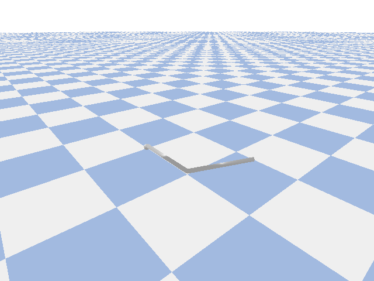

# 项目 A · 两连杆机械臂运动学

## 这是什么

从零实现两连杆机械臂的运动学链路：自己写 URDF → 正运动学 → 与物理引擎对账。



## 现在做到哪

| 模块 | 状态 | 文件 |
|---|---|---|
| 正运动学（几何推导） | ✅ | `day1_fk2link.py` |
| 正运动学（齐次变换） | ✅ | `day2_fk_homo.py` |
| URDF 建模 | ✅ | `day3_two_link_arm_2.urdf` |
| PyBullet 加载与控制 | ✅ | `day3_load_arm.py` |
| FK 对账（八组角度） | ✅ | `day4_fk_verify.py` |
| C++ 智能指针实践 | ✅ | `day5_smart_ptr.cpp` |
| C++ 一阶低通滤波器 | ✅ | `day5_lowpass.cpp` |
| 演示动画生成 | ✅ | `day6_make_demo.py` |
| 逆运动学 IK | ⏳ W4 | — |
| 关节 PID 控制 | ⏳ W5 | — |

## 怎么跑

需要 Python 3.11 + pybullet + numpy + matplotlib
（环境搭建见仓库根目录 `setup_env.sh`，虚拟环境在 `~/pybullet-env`）：

```bash
# 核心验证：八组角度，手推 FK vs PyBullet
~/pybullet-env/bin/python week03_fk/day4_fk_verify.py

# 带界面的机械臂演示
~/pybullet-env/bin/python week03_fk/day3_load_arm.py

# 重新生成 README 里那段动画
~/pybullet-env/bin/python week03_fk/make_demo.py
```
## 验证结果
```
θ1=  0.00 θ2=  0.00   我们=[2. 0.]            仿真的=[2. 0.]            OK
```
θ1=  1.57 θ2=  0.00   我们=[0. 2.]            仿真的=[0. 2.]            OK
```
θ1=  0.00 θ2=  1.57   我们=[1. 1.]            仿真的=[1. 1.]            OK
```
θ1=  3.14 θ2=  0.00   我们=[-2.  0.]          仿真的=[-2.  0.]          OK
```
θ1=  0.00 θ2=  3.14   我们=[0. 0.]            仿真的=[0. 0.]            OK
```
θ1=  0.30 θ2=  0.70   我们=[1.4956 1.137]     仿真的=[1.4956 1.137]     OK
```
θ1= -1.20 θ2=  2.10   我们=[ 0.984 -0.1487]   仿真的=[ 0.984 -0.1487]   OK
```
θ1=  1.05 θ2= -0.79   我们=[1.4659 1.1248]    仿真的=[1.4659 1.1248]    OK
```
全部一致: True
```
## 设计取舍
FK 用两种独立方法实现并互相验证：

- **几何推导** —— `x = L1·cosθ1 + L2·cos(θ1+θ2)`：直观，但只适用于平面两连杆
- **齐次变换** —— `T = Rz(θ1)·Trans(L1)·Rz(θ2)·Trans(L2)`：通用，代价是不直观
- 后者是 **D-H 建模在 α=0、d=0 时的特例**，为 W4 学完整 D-H 打底

## 踩过的坑

- **`θ2` 是相对角**（相对连杆 1），绝对角是 `θ1 + θ2` —— 写成 `θ2` 会算错但不报错
- **齐次变换里 `T[:3,3]` 的平移在父坐标系中表达** —— 要让连杆沿自身方向伸出 `L`，得先乘 `R`
- **PyBullet 的四元数是 `(x,y,z,w)`**，和标准公式的 `(w,x,y,z)` 差一位
- **PyBullet 内部是 float32**，精度 ~1e-7，对账容差要用 `1e-6` 而不是 `1e-9`