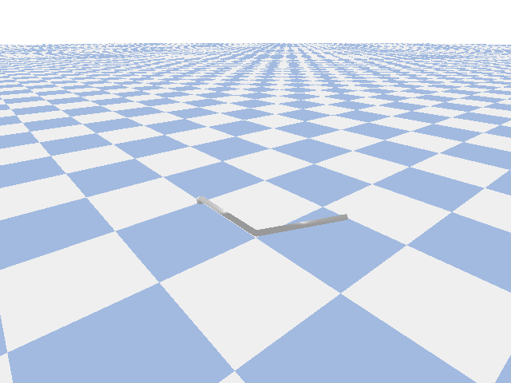

# 项目 A · 机械臂运动学

## 这是什么

从零实现机械臂的运动学链路：自己写 URDF → 正运动学 → 工作空间 → 逆运动学 → 雅可比与奇异位形 → 完整 D-H 建模 → 与物理引擎对账。

全部用两种独立方法实现并互相验证，**关键结论都有量化数字**（见下面「验证结果」）。



## 现在做到哪

### W3 · 两连杆 FK + URDF

| 模块 | 状态 | 文件 |
|---|---|---|
| 正运动学（几何推导） | ✅ | `week03_fk/day1_fk2link.py` |
| 正运动学（齐次变换） | ✅ | `week03_fk/day2_fk_homo.py` |
| URDF 建模 | ✅ | `week03_fk/day3_two_link_arm_2.urdf` |
| PyBullet 加载与控制 | ✅ | `week03_fk/day3_load_arm.py` |
| FK 对账（八组角度） | ✅ | `week03_fk/day4_fk_verify.py` |
| C++ 智能指针实践 | ✅ | `week03_fk/day5_smart_ptr.cpp` |
| C++ 一阶低通滤波器 | ✅ | `week03_fk/day5_lowpass.cpp` |
| 演示动画生成 | ✅ | `week03_fk/day6_make_demo.py` |

### W4 · IK + 完整 D-H

| 模块 | 状态 | 文件 |
|---|---|---|
| 工作空间与可达性判定 | ✅ | `week04_ik_dh/day1_ik_geometry.py` |
| 逆运动学 IK（解析解，含双解与无解判定） | ✅ | `week04_ik_dh/day2_ik_solve.py` |
| 雅可比矩阵 · 奇异位形 · 边界 | ✅ | `week04_ik_dh/day3_ik_edge.py` |
| 完整 D-H（四参数 θ/d/a/α） | ✅ | `week04_ik_dh/day4_dh_matrix.py` |
| D-H 建系三规则 + 手画两例 | ✅ | `week04_ik_dh/day5_dh_table.md` |
| 标准型 vs 改进型（Craig） | ✅ | `week04_ik_dh/day6_two_conventions.py` |
| 三连杆 `α=+90°` 与 PyBullet 对账 | ✅ | `week04_ik_dh/day6_pybullet_verify.py` |
| C++ 虚函数 / 虚表 / 虚析构 | ✅ | `week04_ik_dh/day5_virtual.cpp` |
| C++ P 控制器 class | ✅ | `week04_ik_dh/day6_p_controller.cpp` |
| **回归测试（12 项一次跑完）** | ✅ | `week04_ik_dh/day7_verify.py` |

| 还没做 | |
|---|---|
| 关节 PID 控制 | ⏳ W5 |
| 末端闭环 / 数值 IK（阻尼最小二乘） | ⏳ W5–W6 |

## 怎么跑

需要 Python 3.11 + pybullet + numpy + matplotlib
（环境搭建见仓库根目录 `setup_env.sh`，虚拟环境在 `~/pybullet-env`）：

```bash
# W4 回归测试：把 IK / 雅可比 / D-H / 两套约定的验证一次跑完
~/pybullet-env/bin/python week04_ik_dh/day7_verify.py

# 三连杆 D-H 与 PyBullet 对账（α=+90°，最硬的一项）
~/pybullet-env/bin/python week04_ik_dh/day6_pybullet_verify.py

# 核心验证：八组角度，手推 FK vs PyBullet
~/pybullet-env/bin/python week03_fk/day4_fk_verify.py

# 带界面的机械臂演示
~/pybullet-env/bin/python week03_fk/day3_load_arm.py

# 重新生成 README 里那段动画
~/pybullet-env/bin/python week03_fk/day6_make_demo.py
```

## 验证结果

### W3 · 两连杆 FK vs PyBullet

```
θ1=  0.00 θ2=  0.00   我们=[2. 0.]            仿真的=[2. 0.]            OK
θ1=  1.57 θ2=  0.00   我们=[0. 2.]            仿真的=[0. 2.]            OK
θ1=  0.00 θ2=  1.57   我们=[1. 1.]            仿真的=[1. 1.]            OK
θ1=  3.14 θ2=  0.00   我们=[-2.  0.]          仿真的=[-2.  0.]          OK
θ1=  0.00 θ2=  3.14   我们=[0. 0.]            仿真的=[0. 0.]            OK
θ1=  0.30 θ2=  0.70   我们=[1.4956 1.137]     仿真的=[1.4956 1.137]     OK
θ1= -1.20 θ2=  2.10   我们=[ 0.984 -0.1487]   仿真的=[ 0.984 -0.1487]   OK
θ1=  1.05 θ2= -0.79   我们=[1.4659 1.1248]    仿真的=[1.4659 1.1248]    OK

全部一致: True
```

### W4 · 回归测试（`day7_verify.py`，12/12）

```
[1] IK 闭环          500 个随机点 × 2 解，最大还原误差 4.887e-14
[2] 工作空间         洞内/太远返回 []，环上返回 2 解
[3] 雅可比           det(J) = L1·L2·sin(θ2)，210 组，最大偏差 5.551e-16
[4] 奇异位形         θ2=0 两解合并；θ2=π 时任意 θ1 都到原点（零空间）
[5] 完整 D-H         四个初等矩阵连乘 ≡ 课本闭式，200 组，偏差 0.000e+00
[6] 特例关系         dh(θ,0,L,0) ≡ W3 的 link_transform，偏差 0.000e+00
[7] 两套约定         标准型表 ≡ 改进型表（a/α 整列下移一格），偏差 0.000e+00
[8] 三连杆 α=+90°    全零位末端 = (1.7, 0, 0.5)
```

> `0.000e+00` 不是「很小」，是**位级别相同** —— 两边算的是同一批浮点运算，说明两条路数学上完全等价。

### W4 · 三连杆 D-H vs PyBullet（α = +90°）

```
✅ 第 01 组通过 | 误差: 5.20e-07
✅ 第 02 组通过 | 误差: 4.78e-07
...
✅ 第 10 组通过 | 误差: 1.14e-07     （PyBullet 是 float32，容差用 1e-6）
```

**这是整个项目里唯一一个外部检验** —— 前面的对账都是「自己的代码对自己」，只有这里是让一个完全独立的实现给出同一个数。

**而且这个检验有能力失败**：把 D-H 里的 `α1` 从 `+90°` 改成 `0`，误差立刻变成 **2.36 米**。

## 设计取舍

### FK 用两种独立方法实现并互相验证

- **几何推导** —— `x = L1·cosθ1 + L2·cos(θ1+θ2)`：直观，但只适用于平面两连杆
- **齐次变换** —— `T = Rz(θ1)·Trans(L1)·Rz(θ2)·Trans(L2)`：通用，代价是不直观
- 后者是 **完整 D-H 在 α=0、d=0 时的特例**（W4 已验证：两者位级别相同）

### IK 用解析解而不是迭代

两连杆的 IK 有闭式解，不需要数值迭代：

```
c2 = (x² + y² - L1² - L2²) / (2·L1·L2)
s2 = ±√(1 - c2²)          ← 正负号 = 两个解（肘上 / 肘下）
θ2 = atan2(s2, c2)
θ1 = atan2(y, x) - atan2(L2·s2, L1 + L2·c2)
```

- **必须用 `atan2` 不能用 `arccos`**：`arccos` 只返回 `[0, π]`，丢掉符号信息，两个解会塌成一个
- `|c2| > 1` → 够不着，返回空
- 浮点误差会让边界点的 `c2` 略微超出 1（如 `1.0000000000000004`），要 **先带容差判断、再 `clip` 到 `[-1, 1]`**，否则 `sqrt` 会出 `nan`

### D-H 统一用标准型（2026-11-04 决定）

```
标准型：T_i = Rz(θ_i) · Tz(d_i) · Tx(a_i) · Rx(α_i)      参数下标都是 i
```

**不用改进型（Craig）**：`Rx(α_{i-1})·Tx(a_{i-1})·Rz(θ_i)·Tz(d_i)`

理由：
1. W3 的 `link_transform` 是它 `d=α=0` 的特例，能直接对账
2. 和 URDF 的 `<origin>` 对应更顺 —— **关节 `i+1` 的 origin 装的是第 `i` 行的参数**
3. 查资料、看论文，标准型更普遍

⚠️ **两套绝不能混用**：公式顺序和下标要同时改。只改一个的话，末端位置差将近 1 米，而**程序不报错** —— 它只是给出了一只根本不存在的机械臂。

## 踩过的坑

- **`θ2` 是相对角**（相对连杆 1），绝对角是 `θ1 + θ2` —— 写成 `θ2` 会算错但不报错
- **齐次变换里 `T[:3,3]` 的平移在父坐标系中表达** —— 要让连杆沿自身方向伸出 `L`，得先乘 `R`
- **PyBullet 的四元数是 `(x,y,z,w)`**，和标准公式的 `(w,x,y,z)` 差一位
- **PyBullet 内部是 float32**，精度 ~1e-7，对账容差要用 `1e-6` 而不是 `1e-9`
- **`getLinkState` 返回的 `[0][1]` 是质心、`[4][5]` 才是 link 坐标系** —— 对账要用后者
- **`linkIndex` 不是「第几个 link」，是「第几个关节」**：`-1` = base_link
- **奇异位形有两种完全不同的表现**：`θ2 → 0`（伸直）是两个解**温和合并**；`θ2 → π`（折回）是 `θ1` **突然崩塌成乱数**
  - 后者只在 `L1 = L2` 时发生 —— 因为那时 `k1 = L1 + L2·cos(π) = 0`，IK 公式出现 `atan2(0,0)`
  - 但 `det(J) = 0` **跟 `L1/L2` 无关**，`θ2 = 0` 或 `π` 都是奇异
- **「对账能过」只能证明内部自洽** —— 用同一张表算两边，符号写错也照样过。**要么用外部实现验证，要么故意改坏看它会不会失败**
